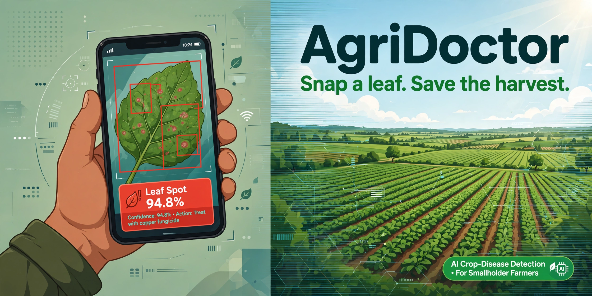
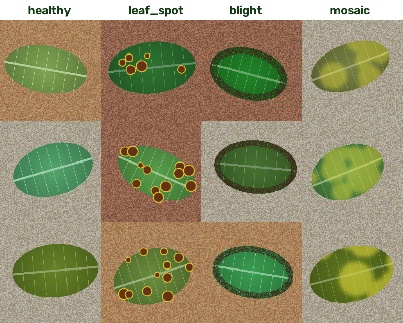
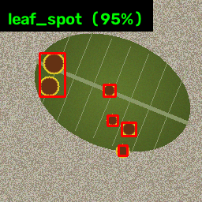
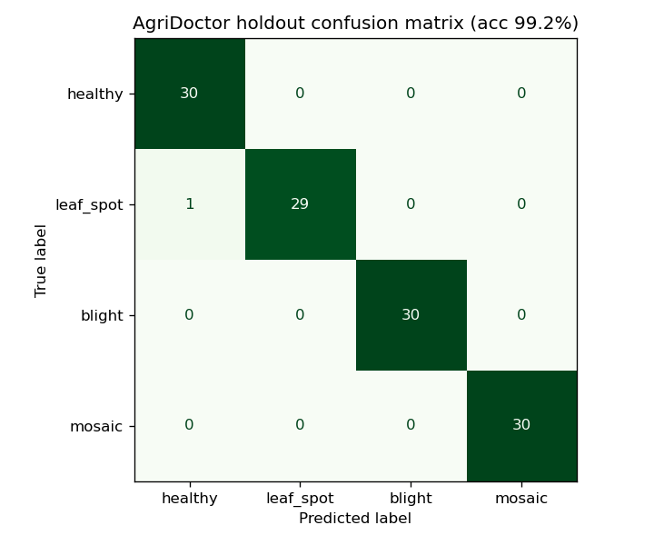

# 🌱 AgriDoctor — Snap a leaf. Save the harvest.

[](https://www.python.org/)
[](https://opencv.org/)
[](https://scikit-learn.org/)
[](https://sdgs.un.org/goals/goal2)
[](LICENSE)
[](tests/test_agridoctor.py)

> **UN Sustainable Development Goal 2: Zero Hunger.** Crop disease wipes out 20–40% of global harvests every year, and smallholder farmers — who grow a third of the world's food — often spot infections only when it's too late. AgriDoctor turns any phone camera into an instant plant pathologist: photograph a leaf, get a diagnosis with a confidence score, and receive treatment guidance on the spot. **100% offline. No API keys. No cloud. No cost.**

---

## 🎯 The Problem

A smallholder farmer notices brown spots on her tomato leaves. Is it fungal leaf spot? Early blight? A virus? The nearest agronomist is a day's travel away, and every day of guessing costs yield. Misdiagnosis means spraying the wrong chemical — wasted money, damaged soil, and a harvest still lost.

## 💡 The Solution

AgriDoctor: point a camera at a leaf → get an instant diagnosis.

1. **Classic computer vision** segments the leaf and extracts 51 hand-crafted features (color, texture, lesion analysis).
2. A **calibrated SVM classifier** (scikit-learn) predicts the disease with a **confidence score**.
3. A **treatment lookup** returns organic *and* chemical guidance for the diagnosed disease.
4. **Batch mode** scans a whole folder of field photos and produces an annotated report with lesion bounding boxes.

Everything runs locally — critical for farms with no connectivity.

## 🚀 Demo (copy-paste)

```bash
git clone <this-repo> && cd agridoctor
pip install -r requirements.txt

# Diagnose a single leaf photo (bundled demos work out of the box)
python -m agridoctor.cli diagnose demo_images/demo_leaf_spot_01.png

# Batch-diagnose a folder -> report.md + annotated images with bounding boxes
python -m agridoctor.cli batch demo_images --out batch_report

# Regenerate the synthetic dataset and retrain from scratch
python -m agridoctor.cli train --per-class 120

# Run the test suite (note: /tmp may be full on some machines)
TMPDIR=~/workspace/.pytest-tmp python -m pytest -q
```

Example output:

```
Image      : demo_images/demo_leaf_spot_01.png
Diagnosis  : leaf_spot — Leaf Spot (brown spot lesions)
Confidence : 94.8%

Treatment guidance — Leaf spot (fungal/bacterial lesions):
  Organic:
    • Prune and destroy affected leaves; do not compost them.
    • Spray neem oil (2%) or a baking-soda solution (1 tsp/L water) weekly.
  Chemical:
    • Apply a chlorothalonil or mancozeb fungicide per label instructions.
```

## ✨ Features

- **Synthetic leaf dataset generator** (`agridoctor/dataset.py`) — programmatically renders 480 labeled leaf PNGs with OpenCV/NumPy: `healthy`, `leaf_spot` (brown lesions with yellow halos), `blight` (scorched leaf margins), `mosaic` (yellow mottling). Seeded & reproducible.
- **Classic CV feature extraction** (`agridoctor/features.py`, 51 dims):
  - HSV color histograms (16 H + 8 S + 8 V bins) over the segmented leaf
  - Edge density via Canny (texture/roughness cue)
  - Simple 8-neighbor LBP texture histogram (16 bins)
  - Lesion analysis: leaf-median-referenced HSV deviation map → connected-component blob detection (blob density + diseased area ratio)
- **Calibrated SVM classifier** (`agridoctor/model.py`) — `StandardScaler → SVC(RBF)` wrapped in `CalibratedClassifierCV`, so `predict_proba` yields honest confidence scores. **99.2% accuracy** on a fresh synthetic holdout (documented baseline: 85%).
- **Treatment guidance** (`treatments.json`) — organic + chemical advice per disease, including a "healthy" maintenance entry.
- **CLI** — `diagnose <image>`, `batch <dir> [--out]`, `train [--per-class N]`.
- **Annotated outputs** — red bounding boxes around detected lesions + diagnosis banner, plus a Markdown batch report.

## 🔬 Tech

| Layer | Choice |
|---|---|
| Image synthesis | OpenCV + NumPy (seeded procedural generation) |
| Segmentation | Background estimation from image corners + largest contour |
| Features | HSV histograms, Canny edge density, LBP texture, median-referenced lesion blobs (51 dims) |
| Classifier | scikit-learn `CalibratedClassifierCV(SVC(RBF))` — confidence via `predict_proba` |
| Interface | argparse CLI (`diagnose` / `batch` / `train`) |
| Runtime | Fully offline, zero API keys |

## 📸 Screenshots

**Synthetic dataset — healthy vs. the three diseases (real generator output):**



**Annotated diagnosis — lesions boxed, confidence banner:**



**Holdout confusion matrix — 99.2% accuracy (baseline 85%):**



## 📁 Structure

```
agridoctor/
├── agridoctor/
│   ├── __init__.py      # class labels + metadata
│   ├── dataset.py       # synthetic leaf image generator (OpenCV/NumPy)
│   ├── features.py      # segmentation + 51-dim CV feature extraction
│   ├── model.py         # calibrated SVM train/save/load
│   ├── treatments.py    # treatment guidance lookup
│   ├── annotate.py      # lesion bounding boxes + label banner
│   └── cli.py           # diagnose / batch / train commands
├── treatments.json      # disease -> organic + chemical guidance
├── scripts/
│   └── build_assets.py  # one-shot: dataset -> model -> visuals -> demos
├── tests/
│   └── test_agridoctor.py  # 16 tests (features, accuracy baseline, treatments, CLI)
├── data/                # generated dataset (480 PNGs, 4 classes)
├── demo_images/         # 5 bundled demo photos — runs out of the box
├── models/model.pkl     # trained classifier (regenerable via CLI)
├── assets/              # hero.png, samples.png, confusion_matrix.png, annotated_demo.png
├── requirements.txt     # numpy, scikit-learn, matplotlib, opencv-python-headless
├── LICENSE              # MIT
└── README.md
```

## 🗺️ Roadmap

- [ ] Fine-tune on real field photos (PlantVillage-style) via domain adaptation from the synthetic set
- [ ] Severity scoring — % leaf area affected → spray / rogue-out thresholds
- [ ] Multi-leaf / whole-canopy mode for drone imagery
- [ ] Offline mobile app (TFLite export) + regional-language treatment cards
- [ ] Severity timeline: track the same plant across days to measure treatment efficacy

## ⚠️ Disclaimer

Treatment guidance is informational and simplified for demonstration — always confirm with a local agronomist and follow product label regulations in your region.

---

*Built for hackathons, aimed at SDG 2: Zero Hunger. MIT licensed — go feed the world.* 🌾
